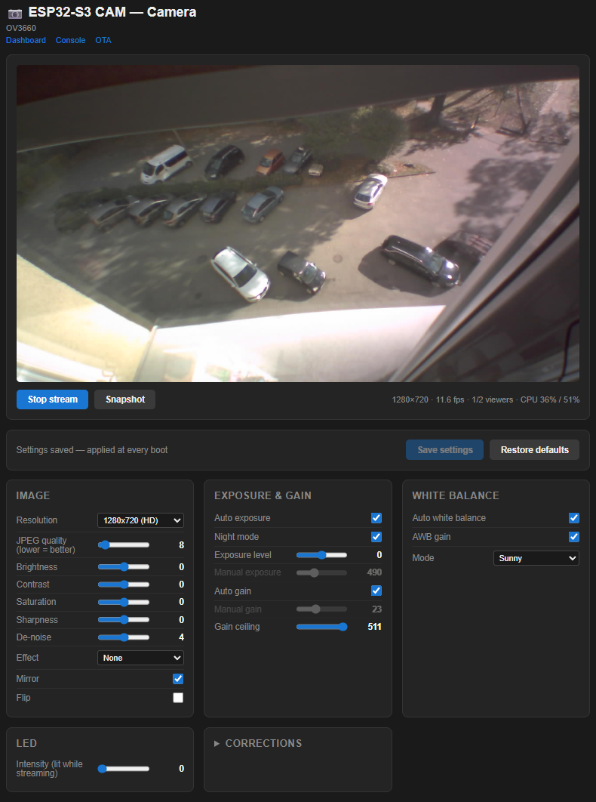
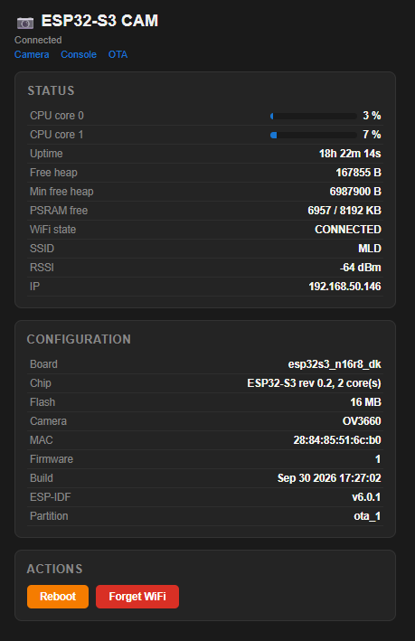

# ESP32S3_CAM

WiFi camera firmware for the ESP32-S3 (N16R8) + OV3660, built on ESP-IDF 6.0.1.
Browser live view (MJPEG), web panel with log console, WiFi setup portal, OTA updates with rollback, and optional periodic JPEG upload.

  
  

## Build

Requires **ESP-IDF v6.0.1** (other versions are untested).

In VS Code with the ESP-IDF extension, set target `esp32s3`, pick your COM port and flash method `UART`, then run **Build, Flash and Start a Monitor** from the status bar.

Use the dev kit's **UART/COM** USB port, not the native USB one, or you won't see logs.
`sdkconfig` isn't committed. To keep a setting, put it in `sdkconfig.defaults` or `boards/<board>/sdkconfig.board`.

## Use

1. Connect to the **`ESP32S3-Config`** hotspot and pick your WiFi network (portal at `http://192.168.4.1`).
2. Get the device IP from the serial log, or run `wifi status`.
3. Open `http://<device-ip>/`. The camera is at `/camera`, the raw stream at `/camera/stream`.

Type `help` in the serial monitor or at `/console` to list the shell commands.

**OTA:** upload `build/esp32s3_cam.bin` at `/ota`, or run `python tools/ota_push.py --ip <ip> --file build/esp32s3_cam.bin`.
