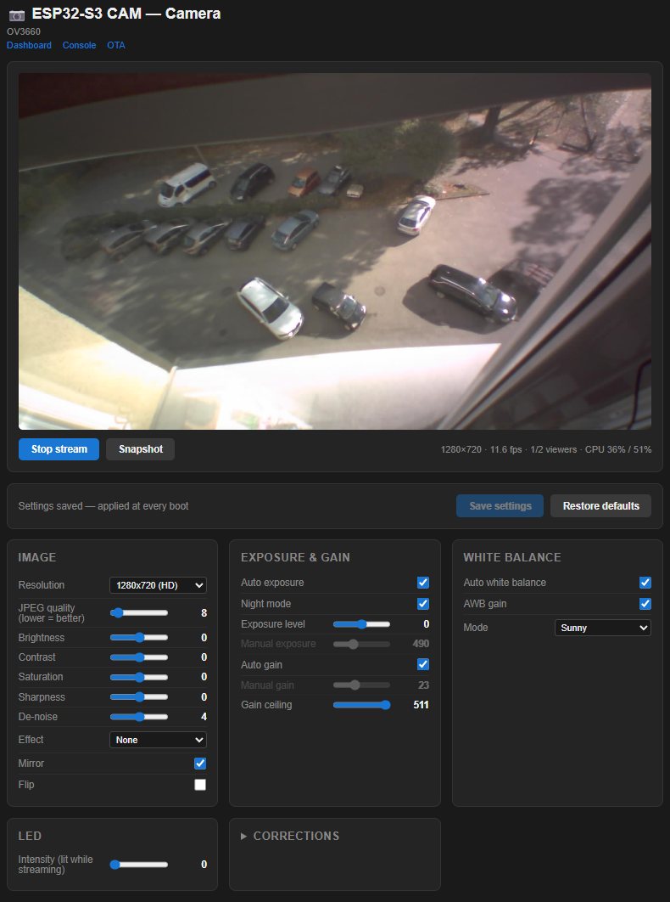
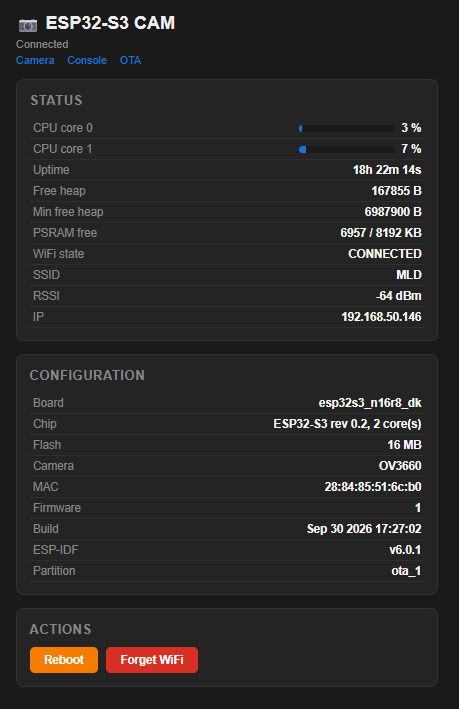

# ESP32S3_CAM

WiFi camera firmware for the ESP32-S3 (N16R8) + OV3660, built on ESP-IDF 6.1 in a Docker environment.
Browser live view (MJPEG), web panel with log console, WiFi setup portal, OTA updates with rollback, and optional periodic JPEG upload.

<p>
  
  
</p>

## Layout
- `boards/<board>/` - board definition: `bsp.h` (pins), `partitions.csv`, `sdkconfig.board`
- `software/application/main` - `app_main` (init sequence only)
- `software/application/config` - sdkconfig overlays: `proj.conf`, `debug.conf`, `release.conf`
- `software/modules` - one ESP-IDF component per module
- `test/unit` - host unit tests (Ceedling)
- `cmake/` - helper modules (versioning, clang-format, size report)
- `tools/` - Docker entrypoint, devcontainer, VS Code templates, `ota_push.py`

## Docker
```
docker network create docker-shared      # once
docker-compose build
docker-compose run -e LOCAL_USER_ID=$(id -u) idf bash
```
The container has **no USB access**: it only builds. Flash from the host.

## Build (inside the container)
```
make build                      # configure + build (debug)
make build debug=n              # release
make build board=<board>        # other board from boards/ (use a fresh build_dir=...)
make test                       # host unit tests
make style-check                # / style-format
make size-analysis
make install                    # artifacts -> _deploy/<build_dir>/bin
```
`sdkconfig` is generated into the build directory. To keep a setting, put it in `software/application/config/proj.conf` or `boards/<board>/sdkconfig.board`.
The firmware version (`X.Y.Z-<hash>`) comes from the nearest `X.Y.Z` git tag and is generated into `version.h` by `cmake/versioning/git_version.py`.

## Flash (on the host)
Copy `_deploy/_build_debug/bin` to the host, then from that folder:
```
esptool.py --chip esp32s3 -p <port> write_flash @flash_args
```
Use the dev kit's **UART/COM** USB port, not the native USB one, or you won't see logs.

## Use

1. Connect to the **`ESP32S3-Config`** hotspot and pick your WiFi network (portal at `http://192.168.4.1`).
2. Get the device IP from the serial log, or run `wifi status`.
3. Open `http://<device-ip>/`. The camera is at `/camera`, the raw stream at `/camera/stream`.

Type `help` in the serial monitor or at `/console` to list the shell commands.

**OTA:** upload `esp32s3_cam.bin` at `/ota`, or run `python tools/ota_push.py --ip <ip> --file _deploy/_build_release/bin/esp32s3_cam.bin`.
